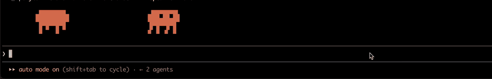

# enter000-plugins

Plugins for [Claude Code](https://github.com/anthropics/claude-code), the terminal AI coding
agent.

```
/plugin marketplace add enter000/enter000-plugins
/plugin install clawd-runner@enter000-plugins
```

## clawd-runner: a Clawd pet for Claude Code



A terminal pet for Claude Code: two pixel Clawds, the Claude Code mascot, live in the strip above
your prompt. A tamagotchi-style companion that keeps you company while the agent writes your code.

They have needs and moods of their own: energy, boredom, curiosity, a wish for company. They
wander, nap when tired, sit, sniff around, play tag and keep the score, copy each other's jumps and
leap over a sleeping friend. They watch you type, wait with you while the agent works, cheer when
it is done, flinch when a command fails and dance when tests pass.

Now and then they comment on your work in speech bubbles: the draft you are typing, the files the
agent touches, the commands that failed, the time of day. They are two pompous snobs who think
they would have written it better. Remarks come in the language you write to the agent in, or one
you set.

### Commands

- `/clawd` hides or shows them
- `/clawd quiet` / `/clawd talk` turns their remarks off or on; each remark is a small model call
- `/clawd lang <language>` sets the language of their remarks (`English`, `Deutsch`, anything the
  model understands); `/clawd lang auto` goes back to the language you write in
- `/clawd model <name>` picks the model for their remarks (`haiku`, `sonnet`, a full model id);
  `/clawd model` shows the current one. Default: `sonnet`. The once-a-turn remark that recalls the
  whole session runs on the session's own model
- `/clawd stats` shows today's calls and tokens
- `/clawd <anything else>` is an order to them: "dance", "go to the corners", "come here", "sleep"

### Cost

Remarks are short model calls on your Claude Code account: one every 20 seconds or so when idle,
more often while you type or the agent works. `/clawd model haiku` makes them cheaper, `/clawd
quiet` stops them; the Clawds keep living without them.

## License

MIT. A fan-made plugin, not affiliated with or endorsed by Anthropic. Clawd and Claude are
Anthropic's.
